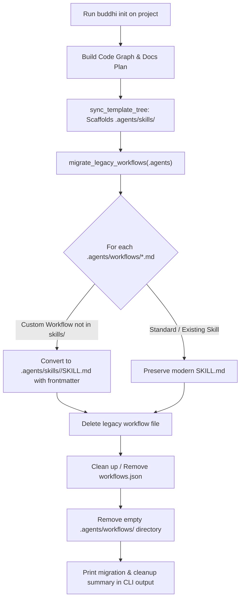

# Implementation Plan: Legacy Workflow Removal & Skill Migration in `buddhi init`

## Context & Motivation

Antigravity has deprecated Markdown-based workflows (`.agents/workflows/*.md`) in favor of structured Agent Skills (`.agents/skills/<name>/SKILL.md`). In `buddhi-cli`, all 11 core harness workflows have been converted to skills.

However, when `buddhi init` is run against an existing project previously initialized with an older version of `buddhi-cli`:
1. The project still contains `.agents/workflows/` with legacy `.md` files.
2. If legacy workflow files remain, Antigravity experiences command and discovery conflicts: typing `/<command>` or triggering autonomous tasks can match both the legacy workflow and the modern skill.
3. Simply renaming `.md` to `.md.bak` leaves the deprecated `.agents/workflows/` directory in the repository, leaving clutter and potential conflicts.
4. If `.agents/workflows.json` exists, leaving an empty manifest is redundant.
5. In `src/buddhi/templates/agents/hooks.json`, the command path must be `"python hooks/guard_destructive.py"` to ensure newly initialized harnesses execute hooks from their working directory (`.agents`) without error.

---

## Technical Architecture



---

## Proposed Changes

### 1. `src/buddhi/util/fsutil.py`
Update `WorkflowMigrationReport` and `migrate_legacy_workflows`:
- Track `removed: list[Path]` instead of just `archived`.
- For each workflow `.agents/workflows/<name>.md`:
  - If `.agents/skills/<name>/SKILL.md` does not exist (custom user workflow), convert it to `.agents/skills/<name>/SKILL.md` with guaranteed valid YAML frontmatter (`name` and `description`).
  - If `.agents/skills/<name>/SKILL.md` already exists, preserve the skill.
  - Delete the legacy `.md` file (and any `.md.bak` files).
- Clean up `.agents/workflows.json`: if it exists and becomes empty, unlink it so no orphaned manifest remains.
- Remove the `.agents/workflows/` directory once all workflow files have been processed and removed (`shutil.rmtree(workflows_dir)` or `rmdir`), ensuring `(agents_dir / "workflows").exists()` is `False`.

### 2. `src/buddhi/commands/init.py`
- Update the summary output when workflows are migrated:
  ```python
  if migration_report.migrated or migration_report.removed:
      console.print(
          f"  migrated legacy workflows: {len(migration_report.migrated)} converted to skills, "
          f"{len(migration_report.removed)} legacy workflows removed"
      )
  ```

### 3. `src/buddhi/templates/agents/hooks.json`
- Ensure line 9 uses `"command": "python hooks/guard_destructive.py"` instead of `"python .agents/hooks/guard_destructive.py"`, matching Antigravity's hook execution working directory (`<root>/.agents`).

### 4. Tests (`tests/test_cli_init.py` & `tests/test_fsutil.py`)
- In `tests/test_cli_init.py`:
  - Update `test_init_migrates_and_archives_legacy_workflows` (rename to `test_init_migrates_and_removes_legacy_workflows`):
    - Verify custom user workflows are converted into `.agents/skills/<custom>/SKILL.md`.
    - Verify bundled skills are preserved.
    - Assert `not (agents_dir / "workflows").exists()`.
    - Assert `workflows.json` is cleaned up/removed.
- In `tests/test_fsutil.py`:
  - Update unit tests for `migrate_legacy_workflows` to verify complete removal of the `.agents/workflows` directory and manifest cleanup.

---

## Verification Plan

### Automated Verification
Run via `terminal-runner` or terminal command:
1. `uv run pytest` — verify full test suite passes including init idempotency and migration cleanup.
2. `uv run ruff check .` — linting check.
3. `uv run mypy src/` — strict typing check.

### Manual Verification
- Simulate an older harness with `.agents/workflows/` containing both standard workflows and a custom workflow, run `uv run buddhi init`, and verify `.agents/workflows/` is cleanly gone and the custom skill exists under `.agents/skills/<custom>/SKILL.md`.

