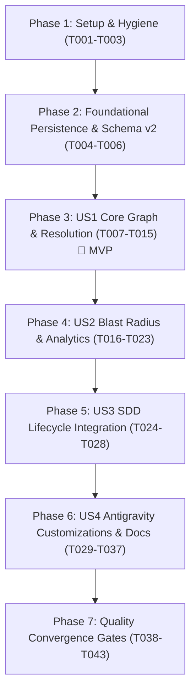

# Tasks: Graphify-Inspired Code Graph Intelligence, Blast Radius Analysis & Antigravity SDD Integration

**Input**: Design documents from `/.buddhi/specs/007-analyze-graphify-and/` (`spec.md`, `plan.md`)

**Prerequisites**: `plan.md` (completed), `spec.md` (completed)

**Organization**: Tasks are structured sequentially across 6 phases using Fog-of-War slicing by user story (`[P1]`, `[P2]`, `[P3]`, `[P4]`).

## Format: `[ID] [P?] [Story] Description`
- **[P]**: Can run in parallel (different files, independent modules)
- **[Story]**: Maps to user stories in `spec.md` (`US1`, `US2`, `US3`, `US4`)
- All task descriptions specify exact file paths and verifiable completion criteria.

---

## Phase 1: Setup & Environment Hygiene

**Purpose**: Guard workspace integrity and prepare data models and git ignore rules before implementation.

- [x] T001 [P] Ensure `./temp/` and scratch paths are excluded from workspace tracking in `.gitignore` and add `"temp"` and `".agents"` to `DEFAULT_EXCLUDED_DIRS` in `src/buddhi/discovery/walker.py`
- [x] T002 [P] Extend core graph data models in `src/buddhi/graph/model.py`: update `GraphEdge` with `confidence`, `confidence_score`, `context`; add `CommunityInfo` dataclass; attach `communities` and `built_at_commit` to `CodeGraph`
- [x] T003 [P] Implement `src/buddhi/graph/cache.py` to handle SHA-256 computation, AST extraction cache serialization, and git `HEAD` commit resolution (`get_git_head_sha`)

**Checkpoint**: Models and hygiene in place; run `uv run pytest tests/test_model.py` to verify baseline model integrity.

---

## Phase 2: Foundational — Schema v2 & Caching Persistence (Blocking)

**Purpose**: Database Schema v2, migration compatibility, and atomic persistence.

- [x] T004 Implement Schema v2 DDL in `src/buddhi/persist/sqlite_writer.py` (`edges` confidence/context columns, `communities` table, `extract_cache` table, `meta` keys) with backward-compatible reader helpers (`get_db_capabilities`) and Windows `os.replace` backoff
- [x] T005 [P] Update `src/buddhi/persist/json_writer.py` to serialize `confidence`, `confidence_score`, `context`, and `communities` into Cytoscape JSON output
- [x] T006 Write tests in `tests/test_sqlite_writer.py` verifying Schema v2 table creation, index presence, `extract_cache` round-trip serialization, and Schema v1 reader compatibility

**Checkpoint**: Schema v2 verified; database writer passes unit tests.

---

## Phase 3: User Story 1 — Cross-File Resolution, Confidence Tiers, Named Leiden Communities & Incremental Cache (Priority: P1) 🎯 MVP

**Goal**: Resolve cross-file calls and class inheritance across project symbols, assign deterministic hub-named Leiden communities with cohesion scores, and skip tree-sitter re-parsing for unchanged files using SHA-256 caching.

**Independent Test**: Run `uv run buddhi generate` on multi-file projects with imports, function calls, and class inheritance; verify resolved `CALLS` and `INHERITS` edges, `confidence` tiers, deterministic `communities` table entries, and SHA-256 cache hits on repeated runs.

### Tests for User Story 1
- [x] T007 [P] [US1] Extend `tests/test_extractor_languages.py` with test fixtures for base class/interface/trait captures (`@inherit.base`) and named imports (`@import.symbol`) across supported languages
- [x] T008 [P] [US1] Extend `tests/test_resolver.py` testing cross-file explicit import calls, module-qualified calls, inheritance resolution (`INHERITS` edges), and confidence tier assignment (`EXTRACTED`, `INFERRED`, `AMBIGUOUS`)
- [x] T009 [P] [US1] Extend `tests/test_clustering.py` testing canonical edge sorting under multiple `PYTHONHASHSEED` values, super-hub exclusion and reattachment, sub-splitting, and cohesion calculation

### Implementation for User Story 1
- [x] T010 [P] [US1] Update tree-sitter `.scm` query files in `src/buddhi/languages/queries/` (`python.scm`, `typescript.scm`, `javascript.scm`, `go.scm`, `rust.scm`, `java.scm`, `kotlin.scm`, `csharp.scm`, `swift.scm`) to capture `@inherit.base` and `@import.symbol`
- [x] T011 [US1] Update `src/buddhi/graph/extractor.py` to extract `RawInheritance` records, capture imported symbol names on `RawImport`, strip live `ts.Node` handles for clean JSON caching, and update `ExtractedFile`
- [x] T012 [US1] Update `src/buddhi/graph/builder.py` to integrate `cache.py` (caching `ExtractedFile` per SHA-256), collect `PendingInheritance`, and tag structural `CONTAINS` edges with `confidence="EXTRACTED"`
- [x] T013 [US1] Upgrade `src/buddhi/graph/resolver.py` with a project-wide `SymbolIndex` (`file_exports`, `global_symbols`, `named_imports_map`, `file_imports_map`), resolve cross-file calls, resolve `INHERITS` edges, and assign confidence tiers (`EXTRACTED`, `INFERRED`, `AMBIGUOUS`)
- [x] T014 [US1] Upgrade `src/buddhi/graph/clustering.py` with canonical edge sorting (100% hash-seed determinism), super-hub exclusion (`degree > max(50, p99_degree)`) with neighbor-majority reattachment, oversized/low-cohesion sub-splitting, cohesion score calculation, and hub-based community naming
- [x] T015 [US1] Update `src/buddhi/graph/pipeline.py` and `src/buddhi/commands/generate.py` / `init.py` to orchestrate cache loading, graph assembly, resolution, clustering, and `built_at_commit` metadata recording

**Checkpoint**: User Story 1 complete; run `uv run pytest tests/test_resolver.py tests/test_clustering.py tests/test_sqlite_writer.py` to confirm MVP slice passes.

---

## Phase 4: User Story 2 — Blast Radius Engine, Topological Analytics & Token-Bounded MCP Retrieval (Priority: P2)

**Goal**: Deliver the Blast Radius engine, graph analytics (`god_nodes`, `surprises`, `questions`, `shortest_path`, `cycles`, `community`, `stats`), unified `buddhi_graph` MCP tool, `buddhi graph` CLI, and token-bounded `buddhi_search`.

**Independent Test**: Invoke `buddhi graph blast-radius`, `buddhi graph analyze`, and `buddhi graph stats` via CLI (`--json`); execute `buddhi_graph` and `buddhi_search` MCP tools against fixture databases verifying blast-radius outputs, topological rankings, and strict token-budget conformance.

### Tests for User Story 2
- [x] T016 [P] [US2] Create `tests/test_graph_analyze.py` testing `compute_blast_radius` (file/symbol/git-diff targets, Hub-Blocked Reverse BFS, transitive callers, risk tiers), `get_god_nodes`, `get_surprising_connections`, `suggest_questions`, `find_shortest_path` with disambiguation, and `find_import_cycles`
- [x] T017 [P] [US2] Create `tests/test_cli_graph.py` testing `buddhi graph blast-radius`, `analyze`, `path`, `cycles`, `community`, and `stats` subcommands (both human output and `--json`)
- [x] T018 [P] [US2] Extend `tests/test_mcp_server.py` and `tests/test_search.py` verifying all 8 `buddhi_graph` actions, IDF multi-field scoring with squared coverage, Hub-Blocked 2-Hop BFS, and token budget enforcement

### Implementation for User Story 2
- [x] T019 [P] [US2] Implement `src/buddhi/graph/analyze.py` providing `get_god_nodes`, `get_surprising_connections`, `suggest_questions`, `find_shortest_path` (with structured candidate disambiguation), `find_import_cycles`, `get_community_detail`, and `get_graph_stats`
- [x] T020 [P] [US2] Implement `src/buddhi/graph/blast_radius.py` providing `compute_blast_radius` supporting file paths, symbol IDs, and git revisions/diffs (`git_ref`, `--staged`, working tree) with Hub-Blocked Reverse BFS, affected communities, crossed bridges, and risk classification
- [x] T021 [US2] Implement `src/buddhi/mcp/tools/graph.py` and register the `buddhi_graph` tool in `src/buddhi/mcp/server.py` supporting all 8 actions with Markdown and JSON output modes
- [x] T022 [US2] Implement `src/buddhi/commands/graph_cmd.py` and register `graph_app` in `src/buddhi/cli.py` exposing `buddhi graph` subcommands (`blast-radius`, `analyze`, `path`, `cycles`, `community`, `stats`)
- [x] T023 [US2] Upgrade `src/buddhi/mcp/tools/search.py` (`execute_buddhi_search`) with IDF-weighted multi-field scoring (`exact`, `prefix`, `substring`, `file_path`, `snippet`), squared term coverage `(matched_terms / total_terms)^2`, and Hub-Blocked 2-Hop BFS with bounded community peer fetching

**Checkpoint**: User Story 2 complete; run `uv run pytest tests/test_graph_analyze.py tests/test_cli_graph.py tests/test_mcp_server.py tests/test_search.py`.

---

## Phase 5: User Story 3 — Graph-Driven Spec-Driven Development (SDD) Integration (Priority: P3)

**Goal**: Integrate the code graph, topological diagnostics, and blast-radius analysis into SDD commands and skills (`buddhi sdd impact`, `buddhi sdd setup-plan`, `/specify`, `/spec-plan`, `/implement`, `/verify`).

**Independent Test**: Run `buddhi sdd setup-plan --json` and `buddhi sdd impact --json` on a test repository; inspect updated skill templates to confirm topological context injection and blast-radius verification gates.

### Tests for User Story 3
- [x] T024 [P] [US3] Extend `tests/test_sdd.py` verifying that `buddhi sdd setup-plan --json` populates `GRAPH_CONTEXT` when `tree-graph.db` exists, degrades gracefully when absent, and `buddhi sdd impact --json` returns a structured blast-radius report

### Implementation for User Story 3
- [x] T025 [P] [US3] Implement `src/buddhi/sdd/impact.py` (`buddhi sdd impact` CLI) computing topological context and git diff impact for active SDD features
- [x] T026 [US3] Update `src/buddhi/sdd/setup_plan.py` and `src/buddhi/commands/sdd.py` to register `buddhi sdd impact` and inject `GRAPH_CONTEXT` into `setup-plan`
- [x] T027 [US3] Update SDD plan template in `src/buddhi/templates/agents/templates/plan-template.md` (and `.agents/templates/plan-template.md`) to include a Topological & Blast Radius Grounding section
- [x] T028 [US3] Update SDD skill definitions in `src/buddhi/templates/agents/skills/` and `.agents/skills/` (`specify`, `explore-unknowns`, `spec-plan`, `spec-tasks`, `implement`, `verify`, `close-spec`, `ask`, `debug`, `status`, `okf-context`) to incorporate `buddhi_graph` and blast-radius verification gates while preserving OKF v0.2 documentation rules

**Checkpoint**: User Story 3 complete; run `uv run pytest tests/test_sdd.py` and verify SDD command output.

---

## Phase 6: User Story 4 — Antigravity Customizations, Hooks, Rules & Attribution (Priority: P4)

**Goal**: Adhere to official Antigravity specifications for Skills, Rules, Subagents, and Hooks, install non-blocking `<50ms` fail-open context hooks, and update documentation and attribution.

**Independent Test**: Validate rule YAML frontmatter, run `graph_context.py` subprocess tests for `SessionStart` and `PreToolUse`, verify `ACKNOWLEDGMENTS.md`, `CHANGELOG.md`, and confirm zero tracked files under `./temp/`.

### Tests for User Story 4
- [x] T029 [P] [US4] Create `tests/test_hook_graph_context.py` testing `graph_context.py` for `SessionStart` staleness output, `PreToolUse` file symbol/community context injection in `<100ms`, and fail-open guarantees (`{"decision": "allow"}`) on malformed input or missing database
- [x] T030 [P] [US4] Extend `tests/test_cli_init.py` and `tests/test_cli_skills.py` validating Antigravity rule frontmatter, subagent tool declarations, and hook registration

### Implementation for User Story 4
- [x] T031 [P] [US4] Implement stdlib-only, fail-open `graph_context.py` in `src/buddhi/templates/agents/hooks/graph_context.py` and `.agents/hooks/graph_context.py`, enforcing workspace path boundary checks and `<50ms` execution
- [x] T032 [P] [US4] Register `graph_context.py` on `SessionStart` and `PreToolUse` in `src/buddhi/templates/agents/hooks.json` and `.agents/hooks.json`, and add idempotent hook merger helper in `src/buddhi/util/fsutil.py` (called in `init.py`)
- [x] T033 [P] [US4] Add official Antigravity YAML frontmatter (`description`, `trigger: always_on` / `glob`) to rules in `src/buddhi/templates/agents/rules/*.md` and `.agents/rules/*.md`, and document `buddhi_graph` in `harness-core.md`
- [x] T034 [P] [US4] Update specialist subagent definitions in `src/buddhi/templates/agents/agents/*.md` and `.agents/agents/*.md` to declare `buddhi_search`, `buddhi_read`, `buddhi_graph`, and `buddhi_memory` in `tools:` frontmatter and instructions
- [x] T035 [US4] Update `ACKNOWLEDGMENTS.md` with a dedicated `Graphify` section (`https://github.com/Graphify-Labs/graphify`, Author: Safi Shamsi, Apache-2.0 / MIT license and NOTICE attribution)
- [x] T036 [US4] Update `CHANGELOG.md` under `## [Unreleased]` detailing all graph, Blast Radius, MCP, CLI, SDD, and Antigravity hook/rule/subagent additions
- [x] T037 [US4] Update `README.md` to document `buddhi graph` subcommands, `buddhi_graph` MCP tool, and Blast Radius SDD workflows

---

## Phase 7: Verification & Quality Convergence Check

**Purpose**: Run full suite of quality gates through `terminal-runner` to verify zero regression and ratchet compliance.

- [x] T038 Execute full test suite: `uv run pytest`
- [x] T039 Execute hash-seed determinism test: `uv run pytest tests/test_clustering.py -k deterministic` under `PYTHONHASHSEED=1` and `PYTHONHASHSEED=42`
- [x] T040 Execute linting and formatting gates: `uv run ruff check .` and `uv run ruff format --check .`
- [x] T041 Execute typechecking: `uv run mypy src/ tests/`
- [x] T042 Execute source file token budget ratchet: `uv run buddhi scripts check-file-size --all` (verify all files `<= 8,000 tokens`)
- [x] T043 Verify repository cleanliness: `git status --porcelain temp/` (confirm zero staged or tracked files in `./temp/`)

---

## Dependencies & Execution Sequence

